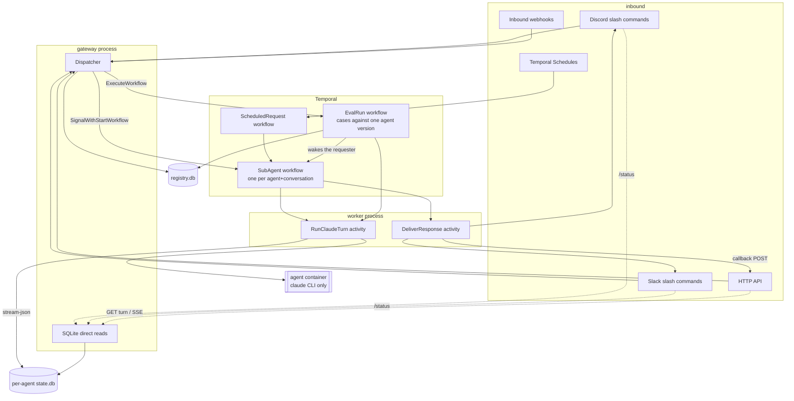

# Architecture

roundclaw is a durable orchestrator for Claude Code. Requests arrive from
Discord, Slack or HTTP, are queued by a per-agent Temporal workflow, and are executed
as `claude -p --output-format stream-json` inside a container that holds nothing
but the `claude` binary.

This document describes what the code does today. Layer detail lives in the
files listed under [Layer index](#layer-index). For how to *use* an agent from
a chat tool or the API rather than how it is built, see [../usage.md](../usage.md).

## System overview



Two paths are deliberately kept apart:

- **Work** goes through Temporal, so it survives a worker crash.
- **Observation and control** (`/status`, `GET /v1/agents/{a}/turns/{t}`, request
  history, versions, SSE) read SQLite directly and never touch Temporal or a
  model. They keep working when an agent is wedged, which is exactly when they
  are needed.

A third, slower loop sits on top of both: **review**. An eval run measures a
pinned agent version, a comparison decides whether a change helped, and a
proposal records a change for a person to approve. It is built from the same
parts — a registry row, a Temporal execution, an agent turn — rather than as a
subsystem beside them; see [orchestration.md](orchestration.md#what-you-register-agents-schedules-workflows-evals).

## Tech stack

| Layer | Choice | Notes |
|-------|--------|-------|
| Language | Go 1.26 | single static binary; `CGO_ENABLED=0` |
| Durability | Temporal Go SDK `go.temporal.io/sdk` v1.46 | workflows, signals, queries, Schedules |
| Temporal server | `temporalio/auto-setup` 1.27 on Postgres 16 | see [infrastructure](infrastructure.md) |
| Storage | `modernc.org/sqlite` v1.54 (pure Go), WAL | one DB per agent + one registry DB |
| Discord | `bwmarrin/discordgo` v0.29 | slash commands, modals, autocomplete |
| Slack | `slack-go/slack` v0.27 | Socket Mode, Block Kit, file upload — see `adr/001` |
| HTTP | `net/http` `ServeMux` (Go 1.22 routing) | no framework |
| Config | `gopkg.in/yaml.v3` | secrets referenced by env var name only |
| Agent runtime | `docker` CLI → `@anthropic-ai/claude-code` on `node:22-slim` | no roundclaw code in the image |
| Testing | `stretchr/testify`, `go.temporal.io/sdk/testsuite` | `go test -race` in CI |

## Directory structure

```
cmd/
├── worker/          # Temporal worker: registers workflows + activities, runs retention
└── gateway/         # Discord + Slack listeners, HTTP server, direct SQLite reads
internal/
├── core/            # Request, Origin, AgentStatus, Usage — shared by every layer, imports nothing local
├── routine/         # routines, pure: contract + graph, the admission compiler, completion rules
├── lifecycle/       # routine lifecycle rules, pure: recurrence, admit, promote, hotspot, archive
├── config/          # YAML config, env indirection, chat permission gating
├── registry/        # runtime CRUD: agents, schedules, workflows, tools, skills,
│                    #   versions (agent, tool, skill), tool identity and
│                    #   reachability, eval sets/runs, proposals (registry.db)
├── store/           # per-agent SQLite: turns, live_logs, runtime, idempotency
├── claude/          # container argv, stream-json decoder, session ID derivation, router
├── adapter/         # inbound/outbound edges: discord*.go, http*.go, dispatch.go,
│                    #   limits.go, proposals.go (the shared apply path)
└── temporal/
    ├── contract/    # workflow IDs, signal/query names, activity input types (leaf package)
    ├── workflow/    # SubAgent, ScheduledRequest, RunWorkflow, EvalRun, RoutineRun — deterministic, no I/O
    └── activity/    # RunClaudeTurn, DeliverResponse, workspace resolution, eval cases, routine steps
e2e/                 # (build tag e2e) routines end to end on a Temporal dev server
container/           # the agent image (claude CLI) + a scripted fake for tests
skills/              # Claude Code skills roundclaw ships: how to manage and review a fleet
Dockerfile           # roundclaw's own binaries
compose.yaml         # Postgres + Temporal + worker + gateway
```

`skills/` is not code. It is the recipe for building a management agent — one
holding a full-scope token and the CLI — written for both readers it has: a
person working in this repository with Claude Code, and the agent itself, which
gets the same directory mounted at `~/.claude/skills/<id>` when the skill is
registered and granted. `admin` and `curator` are conventions built that way, not
features; no code knows either name.

## Layer index

| Document | Covers |
|----------|--------|
| [adapters.md](adapters.md) | Discord and Slack commands, channel references, HTTP API, webhooks, dispatcher, limits, files, proposals |
| [orchestration.md](orchestration.md) | Temporal workflows (including eval runs), activities, signals, contract package |
| [data.md](data.md) | SQLite schemas, versions, eval runs, migrations, retention, cross-process access |
| [agent-runtime.md](agent-runtime.md) | Container invocation, session derivation, workspaces, isolation |
| [delegation.md](delegation.md) | How a delegated result returns (`notify`) and how an agent speaks mid-turn (`say`) |
| [infrastructure.md](infrastructure.md) | Compose topology, images, configuration, CI |

## Module structure

The dependency direction is one-way, from edges inward:

```
cmd/*  →  adapter  →  registry, store, config, core, routine, temporal/contract, temporal/workflow
          activity →  registry, store, config, claude, core, routine, temporal/contract
          workflow →  core, routine, registry (types), temporal/activity (method refs), temporal/contract
          registry →  core, routine
          routine  →  stdlib only
          lifecycle →  stdlib only
          claude   →  core
          core     →  stdlib only
```

`temporal/contract` exists to break a cycle: an activity needs to signal the
agent workflow, and the workflow references the activity's methods. Both depend
on the leaf instead of on each other.

## Import rules

- `core/` imports no other roundclaw package. Everything may import it.
- `routine/` imports only the standard library and does no I/O: the compiler
  learns about the fleet through its `Resolver` interface, so the interpreter
  can call it during replay.
- `temporal/workflow/` must not *call* anything that does I/O — workflow code is
  replayed and must stay deterministic. In practice it imports `activity` for
  method references and `registry` for record types, and calls neither's I/O;
  `routine` is pure and is what the interpreter's control flow is decided by.
- `temporal/activity/` may import anything except `temporal/workflow`.
- `adapter/` may import `registry`, `store`, `config`, `core`, `contract`. It
  must not import `temporal/activity` or `temporal/workflow`; it reaches the
  workflow through the Temporal client and the names in `contract`.
- `store/` and `registry/` must not import `adapter` or `temporal/*`.
- `claude/` must not import `store`, `registry`, or `adapter`. It builds argv
  and parses output; it does not know where either comes from.

## Key patterns

- **Deterministic session identity.** The Claude session ID is derived from the
  workflow ID via UUIDv5 (`claude.SessionID`), never captured from output. A
  retried activity reattaches to the same session with no state to look up.
  See [agent-runtime.md](agent-runtime.md).
- **Origin as a discriminated union.** `core.Origin` carries where a reply must
  go (`discord` / `http_poll` / `http_callback` / `agent`). It is written to
  `turns.origin` and read back by `DeliverResponse`. A new event source is one
  constant plus one switch case — `agent`, which hands a delegated result back to
  the agent that asked for it, was exactly that.
- **Read path bypasses the core.** Status and results are served by reading the
  agent's SQLite file directly, in the gateway process. WAL makes this safe
  while the worker writes.
- **Signal-with-start.** Every submission is a `SignalWithStartWorkflow`, so
  there is no "is the workflow running?" check and no start/signal race.
- **Idempotency at admission.** `turns` rows are inserted by the gateway before
  signalling, inside the same transaction that claims the `Idempotency-Key`.
  A client retry returns the original `turn_id` and starts no second turn.
- **Append-only migrations.** `CREATE TABLE IF NOT EXISTS` is invisible to an
  existing database, so every added column is also an `ALTER TABLE` in a
  `migrations` slice whose duplicate-column error is ignored.
- **Append-only history.** An agent version is never rewritten. A rollback
  applies an old snapshot as a *new* version, so the change being undone stays on
  the record — which is what anyone looks at afterwards. Versions also outlive
  the agent (no foreign key), on the same reasoning that keeps its workspace.
  Tools and skills version the same way, and their versions record a digest of
  what the definition pointed at as well as the definition — a row can stand
  still while the directory or service behind it moves (`adr/005`).
- **One interpreter, graphs as data.** Every routine runs on `RoutineRun`,
  which loads the plan pinned by the run's version; a new routine or version is
  a registry row, never a deploy. See [orchestration.md](orchestration.md#routinerun--one-interpreter-for-every-routine).
- **Cost is read, not computed.** The CLI's reported cost is recorded as given,
  with the model and tokens per model beside it; roundclaw keeps no price table.
- **Verdicts are computed, not summarised.** Whether a change helped is decided
  by `registry.compareRuns` from case-level pass/fail, not by a model reading
  outputs. The reviewer is itself a model, and forming an impression from outputs
  is exactly how a regression gets talked away.

## Constraints

- **Heartbeats are mandatory.** A Temporal activity learns about cancellation
  only through a heartbeat response. `RunClaudeTurn` heartbeats every second and
  the worker sets `MaxHeartbeatThrottleInterval: 1s`; without both, `/stop` and
  `/steer` are delayed by tens of seconds.
- **Every turn runs with cwd `/workspace`.** `claude --resume` scopes its
  session lookup to the working directory, so a turn started elsewhere silently
  fails to find its session.
- **`/home/node/.claude` must be a per-agent host mount.** Containers are
  `--rm`; transcripts live there and `--resume` has nothing to resume without it.
- **The prompt is passed immediately after `-p`.** `--allowedTools` is variadic
  and swallows a trailing positional argument.
- **One Temporal namespace per environment.** Workflow IDs encode agent and
  conversation but not environment, so two deployments sharing a namespace
  deliver each other's signals.
- **No secrets in config.** `roundclaw.yaml` names environment variables
  (`token_env`, `api_key_env`, `oauth_token_env`, `webhook_secret_env`); values
  come from the process environment.
- **Callback URLs must resolve to public addresses.** Checked at admission and
  again at delivery (`core.AssertPublicCallbackHost`); redirects are not
  followed.
